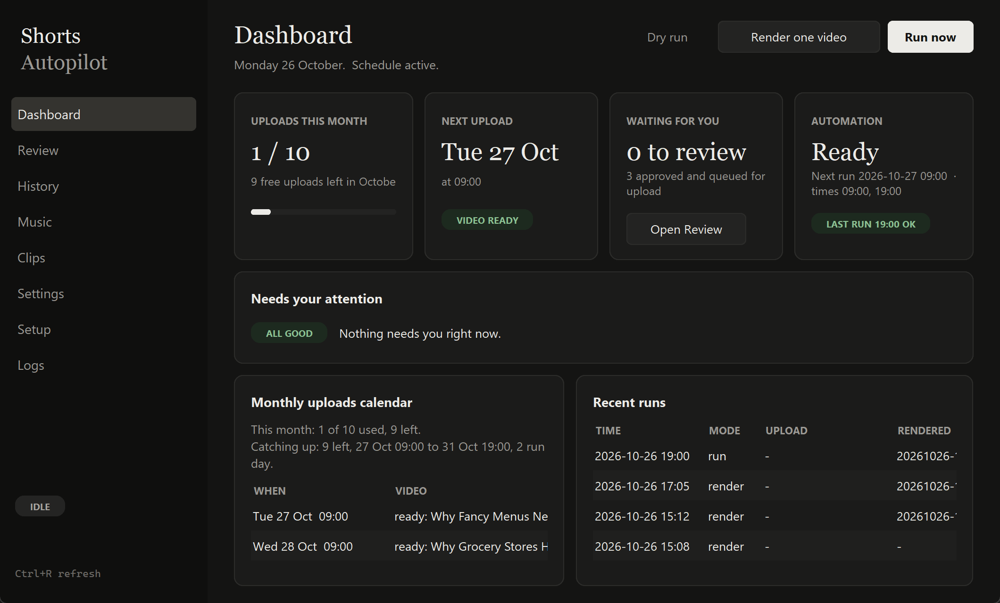

# Shorts Autopilot

A dark-themed Windows app (CustomTkinter) that runs a faceless YouTube Shorts channel almost on its own. It writes and renders Shorts with [MoneyPrinterTurbo](https://github.com/harry0703/MoneyPrinterTurbo), waits for **your approval**, then uploads the approved ones through [Upload-Post](https://upload-post.com). Uploads are spread evenly so every free monthly upload is used, without long gaps.



## What it does

```
 Twice a day (Windows Task Scheduler)
 ┌──────────────────────────────────────────────────────────────────────┐
 │ 1. Upload    if an upload slot is due → post the oldest approved video │
 │ 2. Render    if fewer than 3 videos are waiting → make a new one:     │
 │              topic → script → fast energetic voiceover (exact timing) │
 │              → clips looked at and placed per sentence → best-fit     │
 │              approved music + captions → review/                      │
 │ 3. Clean     delete MoneyPrinterTurbo caches older than 14 days       │
 └──────────────────────────────────────────────────────────────────────┘
          review/  ──you approve in the app──►  approved/  ──►  YouTube
```

- **Topics never repeat.** An LLM (Claude by default) picks a fresh topic in your niche every time.
- **Footage matches the script, to the second.** The voiceover is made first, so every sentence group ("beat") has exact timing. For each beat the app searches several free sources, then **Claude looks at the candidate clips as they will appear on a phone** and picks the best one for the words being spoken. Each clip is cut to the beat's exact length from the calm middle of the footage, so the picture changes when the words do. No clip repeats within a video. See [How clips are chosen](#how-clips-are-chosen).
- **Studio narration:** every sentence is spoken on its own with a chosen pause after it, mastered with warmth and presence, and **checked against the script by Whisper** so a garbled sentence is caught and redone. Free Microsoft neural voices (including the newest Multilingual ones) or Kokoro running offline on this PC. Hear ten of them first with **Audition voices**. See [Narration and sound](#narration-and-sound).
- **Sound design:** whooshes into the cuts and a hit on big numbers, all synthesised here from noise and sine waves (nothing downloaded, so no Content ID risk), with music that ducks under the voice and a mix matched to YouTube's loudness.
- **Checked before you look:** every video gets automatic quality checks (loudness, length, dead air, black or frozen picture, narration match, caption rules) and the Review page says what to look at.
- **Motion graphics, not a slideshow:** captions that appear word by word exactly as the voice says them, a few keywords and big numbers in one accent colour, a different eased camera move on every cut (never zoom on every cut), one colour grade over all clips, and music that dips under the voice. Everything stays out of the screen areas the Shorts app covers. See [Look and motion](#look-and-motion).
- **Copyright-safe music:** only tracks you've approved are used, otherwise voice only. 8 upbeat Mixkit tracks come ready to use. The AI picks the best fit for each video (or you fix one track, or swap the music per video in Review). See [SAFETY.md](SAFETY.md).
- **Approval required:** nothing is posted until you approve it.
- **Quota-aware schedule:** the remaining uploads are spread over the remaining run times of the month.
- **Long films:** the **Long video** page makes an 8-10 minute animated story with a narrator and 4-5 talking cartoon characters, explanation cards and a full sound mix, rendered with HyperFrames. See [Long videos](#long-videos).

## Requirements

| What | Why | Cost |
|---|---|---|
| Windows 10/11, 8 GB RAM, ~10 GB free disk | rendering | - |
| [git](https://git-scm.com) and [uv](https://docs.astral.sh/uv/) | the installer uses them to set up MoneyPrinterTurbo | free |
| An LLM: [Claude Code](https://claude.com/claude-code) CLI (default, uses your Claude plan), or a DeepSeek / Gemini / OpenAI / OpenRouter key, or local Ollama | writes topics, scripts, search words, titles | plan or API cost |
| [Pixabay API key](https://pixabay.com/api/docs/) | stock footage (Pexels has paused new keys) | free |
| *Optional:* [Coverr API key](https://api.coverr.co/docs/) | a second footage source | free |
| [Upload-Post](https://upload-post.com) account with your YouTube channel connected | uploading | free plan: 10 uploads a month |

## Install

1. Clone this repo, for example to `D:\PROJECTS\shorts-autopilot`.
2. *(Optional)* To keep MoneyPrinterTurbo somewhere other than `D:\MPT`, copy `env.example.bat` to `env.bat` and edit `MPT_DIR`.
3. Double-click **`install.bat`**. It:
   - clones MoneyPrinterTurbo **v1.3.9** into `MPT_DIR` (skipped if it's already there)
   - installs Python 3.11 and MPT's packages with uv
   - sets up the narration tools in their own environment (`.venv-audio`) and downloads the Kokoro and Whisper models (about 800 MB, once)
   - opens the app
4. In the app, open the **Setup** tab and work down the checklist until every row is green ✔:
   - **Script writer:** choose `claude_code` (no key) or a provider and paste its key, then **Save**.
   - **Stock footage:** paste your Pixabay key, then **Save**. A Coverr key is optional and adds a second source.
   - **Upload-Post:** tick Enabled, paste the API key and enter the **profile name**, then **Save**. The profile name is the user listed on Upload-Post's *Users* page (often `default`), not your email.
   - **Daily schedule:** click **Register / repair schedule**.
   - Click **Run full check**: it tests the LLM, footage and Upload-Post in about 20 seconds.
   - Click **Create desktop shortcut** if you like.
5. On the **Dashboard**, click **Render one video now** and review it once it's done (about 10–15 minutes).

Later, open the app from the desktop shortcut or **`Shorts Autopilot.bat`**.

## Using the app

| Tab | What you do there |
|---|---|
| **Dashboard** | Uploads used this month, the next upload slot, queue sizes, schedule state and the last run. **Alerts** flag anything that needs you, such as an upload due with nothing approved. The **upload calendar** shows every planned slot this month and next, and which approved video will go out. **Recent runs** shows each run's upload and render result. Buttons: Run now, Render one video now, Dry run. |
| **Review** | Videos waiting for approval, each with a thumbnail, a ▶ Play button, the script, the voice used, the result of the automatic **quality checks** (*all passed* or what to look at), and an editable **YouTube title, description and tags**. **Approve** moves it to the upload queue. **Reject** asks *why* (a reason is required), deletes the video and keeps your reason to [teach future videos](#learning-from-your-rejections). **♪ Change music...** swaps the track of one video and redoes only the final mix (about a minute). The approved queue shows the upload order, and **Back to review** pulls one out. |
| **Upload** | Your approved videos, ready to post by hand in four clicks: see [Manual uploads](#manual-uploads). Shows whether uploads are automatic or manual right now and why. |
| **History** | Every upload (it counts against the quota), with status and Upload-Post request id. Uploads with an unclear outcome show under **Needs checking**: look in YouTube Studio, then mark **It's live** or **Not uploaded**. **Rejected videos** lists every rejection with your reason, and **What it learned...** shows the rules future videos follow. |
| **Long video** | Make, watch and approve 8-10 minute animated films: start one from a question, follow its progress, **Watch**, **Approve** or **Reject...** it, bring in clips made in Google Vids and copy the title, description and tags for a hand upload. See [Long videos](#long-videos). |
| **Music** | Your approved tracks with their mood tags (the AI uses the tags to match a track to each video). **▶ Listen** plays one. **Add track...** asks for the source, mood tags and a license confirmation. No tracks means voice-only videos. |
| **Clips** | Two things. **Shorts from a video you have the rights to**: choose your own video (or one licensed for reuse), say where it comes from, and the app cuts the best moments into captioned, scored Shorts that wait in Review: see [below](#shorts-from-a-video-you-have-the-rights-to). And your own clip library: footage you download by hand from Mixkit, Vidsplay or Coverr. Add each with a source and a few tags, and the picker considers it whenever the tags match a scene. |
| **Settings** | Niche, language, voice, **voice speed**, script rules, uploads per month, run times, number of videos to keep waiting, **music mode** (AI best fit / always one track / none), music volume, **narration and sound** (voice engine, voice, mastering, sound effects, an **Audition voices** button), **look and motion** (camera moves, colour grade, highlight colour), upload mode, quota cycle, cache cleanup, YouTube privacy. Changing the run times re-registers the schedule. You can also pause or resume the schedule here. |
| **Setup** | Health checklist with a fix button on every row (see Install). |
| **Logs** | The full run log, with a *Problems only* filter. |

### Your routine
Every day or two, open **Review**, watch the new videos, fix titles if needed and **Approve** the good ones. The Dashboard turns red when an upload slot is close and nothing is approved.

## Learning from your rejections

Rejecting a video is feedback, not just a delete. The app asks what was wrong:

| Reason | What it teaches |
|---|---|
| Footage doesn't match what's being said | **footage** rules: which clips to search for and keep |
| Weak or boring opening / script, wrong or risky claim, too long or short, something else | **script** rules: how the voiceover is written |
| Topic is dull, repetitive or off-niche | **topic** rules: which topics get picked |
| Voice, captions or music problem | logged only: change the voice, music volume or tracks in **Settings** and **Music** |

Add **details** when you can (for example *"animals in a money video, I want office and cash shots"*). Specific notes teach much better than a category alone.

How the learning works:
1. Each rejection is appended to `feedback.jsonl` with its reason, topic, title and the start of the script.
2. At the next render, the LLM condenses all feedback (newest wins on conflicts) into at most 8 short rules per area, saved in `lessons.json`. If the LLM can't, your raw notes are used instead. The rules are only rebuilt when there is new feedback.
3. The rules are added to the prompts that choose the **topic**, write the **script**, pick the **search words** and filter the **clips**. Rejected topics are never repeated either.
4. Each video's metadata records how many rules were applied (`lessons_applied`). **History → What it learned...** shows them in plain text.

This steers the prompts. It does not retrain a model, so a few specific rejections help more than many vague ones. To start over, delete `lessons.json` and `feedback.jsonl`.

## How upload spacing works

The task runs at each **run time** (default 09:00 and 19:00). On every run:

```
remaining = monthly_uploads - uploads already made this month
slots_left = run times left this month, including this one
upload now if  remaining >= slots_left               (must use every run to fit)
            or runs since the last upload >= slots_left / remaining
```

This spreads uploads evenly and uses the whole free quota. Example with 10 uploads a month:

| Month | Uploads |
|---|---|
| A full month (November) | 1, 4, 7, 10, 13, 16, 19, 22, 25, 28: about every 3 days (at 09:00) |
| Joining late (9 left on 26 Oct) | 27 Oct, then 09:00 and 19:00 from 28 to 31 Oct |

If nothing is approved when a slot comes, that slot is skipped and later slots catch up. It never goes over the monthly limit. On a paid Upload-Post plan, raise **Uploads per month** in Settings.

## Manual uploads

The free Upload-Post plan allows 10 uploads a cycle. When they run out nothing breaks: the app switches itself to **manual mode** and you post the approved videos yourself, in four clicks.

**When it switches** (Settings → *Upload mode* = Automatic): the cycle's uploads are used up, or Upload-Post refuses uploads. A quota or limit error pauses automatic uploads until the next cycle; any other refusal pauses them for a day. Scheduled runs then skip the upload and say so in the log. Automatic uploads resume by themselves when the cycle resets (**Cycle resets on day**, the 25th for this account). To stay manual all the time, choose *Manual* in Settings or press **Always upload manually** on the Upload page.

**The Upload page** lists the approved videos, oldest first. For the selected video one big button walks through four steps, always in the same place:

| Step | What the button does | You |
|---|---|---|
| 1. Open YouTube and copy the title | copies the title, opens YouTube's upload page and shows the video file in Explorer | drag the file into YouTube, paste the title |
| 2. Copy the description | copies the description, including any footage credits | paste it |
| 3. Copy the tags | copies the tags | paste them under *Show more* |
| 4. I posted it | moves the video to *Posted* and selects the next one | |

A reminder under the button lists the two answers YouTube asks for: **altered or synthetic content = Yes** (the voice is AI) and **made for kids = No**. Manual uploads are written to the ledger as `manual`, so they never count against the Upload-Post quota.

`schedule_uploads.ps1` registers one-time tasks that run `--upload-next` at the times you give. It posts the oldest approved video (respecting the quota and the mode) and never renders anything.

**Scheduled runs have no window.** Task Scheduler starts `run_hidden.pyw` (through `pythonw`), which starts `run_daily.bat` hidden. A visible console window can be closed or Ctrl+C'd, and that silently killed runs on 2026-11-03, one of them in the middle of an upload (`logs/crash.log`: `window-CLOSE event`). The run also asks Windows not to sleep while it works. An upload that still gets cut off is moved to **Needs checking** by the next run: it is never retried on its own, so a video can't post twice. After updating from an older version, click **Setup → Daily schedule → Register or repair** (and run `schedule_uploads.ps1` again for any one-time upload tasks) so the tasks use the hidden launcher.

## Long videos

The **Long video** page makes an 8-10 minute animated story in the style of the "What if..." explainers: a narrator, 4-5 cartoon characters who really talk, and explanation cards (a number counting up, a chart drawing itself, a notebook list, myth against reality). You give it a question; it does the rest, and nothing is posted until you approve it.

1. **Screenplay.** Your Claude (the writer the Shorts use) writes a concept, a cast of 4-5 characters (look, personality, voice) and 14-18 scenes, then the lines of each scene with stage directions: mood, gesture, camera shot, explanation card. Open **Edit screenplay** to change anything by hand.
2. **Voices.** Every character has a different Microsoft neural voice and the narrator has another. Every line is spoken on its own; the cartoon mouths follow the loudness of the audio.
3. **Picture.** The screenplay becomes a [HyperFrames](https://github.com/heygen-com/hyperframes) project (HTML, SVG and GSAP, so every frame is exactly reproducible): flat-vector rooms, puppets that blink, breathe, walk, point, shrug and hop, camera moves between wide, medium, two-shot and close-up, captions with the speaker's name. 1920x1080 at 30 fps.
4. **Sound.** Voices mastered, sound effects synthesised on the cuts and big numbers, one or two of your approved music tracks (calm ones first) crossfaded and ducked under the voice, loudness matched to YouTube.
5. **Checks and thumbnail.** Length, picture size, loudness, dead air and black frames are checked, a 1280x720 thumbnail is made, and the title, description (with chapter timestamps) and tags are ready to copy.

**Review stops.** The [research behind this page](docs/RESEARCH_AI_VIDEO_AUTOMATION_QUALITY.md) says to check the brief and the claims before spending half an hour on media, so a film started in the app pauses twice (untick the pause box in **New film** to run straight through). After the script you see the **brief** (the question, the angle, the takeaway, three title options, the opening image) and every real-world claim the writer listed, with the ones it is unsure of marked CHECK. After the build you see a **storyboard sheet** (one frame from every scene, made in seconds) and **plan checks** (length, every character speaks, scene lengths, captions fit, claims). Approve each stop to carry on. A finished film also keeps a record of **what went into it**: voices, music with its licence note, generated clips, the claims, and what YouTube's disclosure question is about.

A 9-minute film takes roughly 30-40 minutes on this PC: about 10 for the script, a few for the voices, 15-20 for the picture (three Chrome workers at below-normal priority, so the PC stays usable). A stopped film continues from where it stopped. Long films have their own lock, so they never hold up the scheduled uploads, and they are never posted automatically: **Upload by hand** gives the copy buttons, like the Upload page.

**Google Vids.** Vids has no API, so the app cannot drive it; this part is by hand. The screenplay marks up to three scenes where a cinematic 8-second cutaway would help and writes the prompt. On the page: **Copy prompt**, **Open Google Vids** (Blank, then Veo), generate, download the MP4 (File, Download), then **Import clip...**. The scene is rendered again with the clip over the animation (the voices are kept). Without a clip the scene stays animated. Personal accounts get about 10 generations a month at no cost; the app never signs in to Google for you.

Set up once by `install.bat` (needs Node.js 22 or newer): `cd longform` and `npm install --ignore-scripts`. HyperFrames fetches its font (Nunito, from Google Fonts) and its own headless Chrome the first time; its usage telemetry is switched off for every render. Everything a film makes lives in `longform/films/<film>/` (git-ignored).

## Shorts from a video you have the rights to

On the **Clips** page, choose a video file (your own recording, one of your long films, or one with a licence that allows reuse), say where it comes from, tick the rights box and click **Make Shorts**. For a source of up to two hours:

1. **Listen.** Whisper (on this PC, nothing uploaded) writes the transcript with a time for every word.
2. **Pick.** Your Claude chooses the best self-contained moments (22-58 s, starting on a hook and ending where a thought is complete); without it, the densest openings are used. Every cut lands on a sentence boundary.
3. **Reframe.** 9:16 either as the whole picture over a blurred copy of itself or cropped to fill the screen, with a punch-in zoom on every second stretch.
4. **Finish.** The same finish as every Short: word-timed captions with highlighted keywords, one look, synthesised sound effects on the cuts and big numbers, an approved music track ducked under the speech, YouTube loudness, automatic checks.
5. **Review.** Each Short waits in Review with its source, time range and your rights statement; the title, description (with your credit line) and tags are editable, and nothing posts until you approve it.

The app only takes a file, never a link, and refuses to start unless the rights are stated and confirmed. Someone else's famous video is not a valid source: see [SAFETY.md](SAFETY.md). From the command line: `run_daily.bat --clipper job.json` with `{"source": "C:/videos/talk.mp4", "n": 3, "frame": "fit", "confirmed": true, "rights": "my own recording"}`. English speech only for now.

## Files and folders

```
shorts-autopilot/
├─ Shorts Autopilot.bat     open the app
├─ install.bat              one-time setup on a new PC
├─ run_daily.bat            one run (the app and run_hidden.pyw call it)
├─ run_hidden.pyw           starts run_daily.bat with no window (what Task Scheduler runs)
├─ setup_schedule.ps1       registers the "MPT Daily Shorts" task
├─ task_common.ps1          shared by both schedule scripts: the hidden-launch action, wake and late-start settings
├─ autopilot_gui.pyw        the app (Tkinter)
├─ daily_shorts.py          the engine: schedule, queue, music, learning, uploads
├─ footage.py               finding, looking at and placing clips
├─ voices.py                the narration step: runs the worker, masters the voice, writes the subtitle files
├─ narrate.py               the narration worker (runs in .venv-audio): Edge or Kokoro, Whisper timing and check
├─ sound.py                 voice mastering and the synthesised sound effects
├─ qa.py                    automatic quality checks on every finished video
├─ .venv-audio/  models/    the narration tools and their model files (install.bat sets them up; git-ignored)
├─ samples/voices/          the voice audition (git-ignored)
├─ backup/                  originals kept before a fix such as --fix-loudness (git-ignored)
├─ motion.py                captions that follow the voice, camera moves, look, ducked mix
├─ schedule_uploads.ps1     registers one-time "post the next approved video" tasks
├─ longform.py              long films: stages, render, mix, checks (folder per film in longform/films)
├─ longform_page.py         the Long video page of the app
├─ clipper.py               Shorts cut from a video you have the rights to; clip_worker.py transcribes it, clipper_page.py is the Clips panel
├─ lf_screenplay.py         the long-film writer: concept, cast, scenes, beats, and the vocabulary the animation knows
├─ lf_plan.py               screenplay + voice timings -> scenes (shots, cards, captions); lf_build.py writes the HyperFrames project
├─ lf_voice.py              one voice per character (runs in .venv-audio); lf_audio.py mixes; lf_finish.py checks, thumbnail, upload text
├─ longform/kit/            the scene kit: rooms.js, rig.js (the puppet), acts.js, cards.js, stage.js, base.css
├─ env.example.bat          → env.bat (your MPT folder; not committed)
├─ safe_music/SOURCES.txt   approved music list with mood tags (audio files are not committed)
├─ clips/SOURCES.txt        your own clip library list (video files are not committed)
│
│  created while running (all git-ignored):
├─ review/  approved/  posted/  check/     videos (.mp4 + .json metadata)
├─ uploads.json             upload ledger (drives the quota)
├─ topics_used.txt          topic history (no repeats)
├─ feedback.jsonl           why you rejected videos
├─ lessons.json             rules distilled from that feedback
├─ settings.json            your Settings tab values
├─ upload_state.json        why automatic uploads are paused, if they are
├─ work/<video>/            kept so the music of a waiting video can be swapped (also holds
│                           words.srt, captions.ass and motion.json for videos made with motion)
└─ logs/daily.log, logs/runs.jsonl, .thumbs/
```

Each video is an `.mp4` plus a `.json` with `topic`, `title`, `description`, `tags`, `music`, `credits`, `clips`, `script` and `rendered`. You can edit the JSON by hand too.

## Settings reference (`settings.json`)

| Key | Default | Meaning |
|---|---|---|
| `niche` | Dark psychology of emotional persuasion and demographic manipulation: the viral checklist of psychological hooks and raw emotional triggers behind why people buy and believe | what every video is about |
| `language` | `en-US` | script and metadata language |
| `voice_engine` | `edge` | `edge` (Microsoft neural voices, free, online), `kokoro` (runs on this PC) or `mpt` (MoneyPrinterTurbo's own voiceover, the fallback) |
| `voice` | `en-US-AndrewMultilingualNeural` | an Edge voice name, or a Kokoro voice such as `af_heart` (press **Audition voices** to hear ten) |
| `voice_rate` | `1.05` | speaking speed (1.0 = normal) |
| `voice_master` | `true` | warmth, presence and a gentle compressor on the voice |
| `sfx_level` | `subtle` | sound effects: `off`, `subtle` (every other cut and big numbers) or `full` (every cut, an intro and a riser) |
| `script_rules` | 150–165 words (about 63–69 seconds), intense emotional curiosity hook, punchy psychological revelation, end with a provocative question | instructions for the script writer |
| `monthly_uploads` | `10` | Upload-Post plan limit |
| `run_times` | `["09:00", "19:00"]` | when the task runs |
| `buffer` | `3` | stop rendering once this many videos are waiting |
| `music_mode` | `auto` | `auto` = the AI picks the best-fitting approved track, `fixed` = always `music_track`, `none` = voice only |
| `music_track` | empty | the track used when `music_mode` is `fixed` |
| `music_volume` | `0.2` | background music level |
| `clean_after_days` | `14` | delete MPT caches older than this (0 = never) |
| `upload_mode` | `auto` | `auto` posts through Upload-Post and switches to manual when the quota is used up; `manual` never posts by itself |
| `quota_reset_day` | `25` | day of the month Upload-Post resets the quota |
| `meter_used` | `0` | the number from Upload-Post's usage meter (the app uses the higher of this and its own count) |
| `motion_level` | `subtle` | `off`, `subtle` or `dynamic`: animated captions and camera moves |
| `look` | `clean` | `clean`, `cinematic` or `warm` colour grade |
| `accent_color` | `#FFD60A` | the one highlight colour for keywords and big numbers |

### Dark Psychology & Emotional Persuasion Matrix

The default niche explores the viral psychological checklist popularized on social media, mapping different demographics to their raw emotional hooks and psychological vulnerabilities:

- **Men** — Lust, respect, primal power, terror of insignificance
- **Women** — Beauty standards, youth, emotional safety, craving adoration
- **Parents** — Peace of mind, serenity, relief from crushing parental guilt, fierce child protection
- **Kids** — Limitless dreams, grand ambitions, pure wonder, thrilling adventure
- **The Rich** — Safety, stability, paranoia of loss, buying back stolen time
- **The Poor / Broke** — Desperate hope, escape from debt, desire to get rich quick, reclaiming dignity
- **The Old** — Youth, vitality, fighting decay, heartbreak of aging, lasting legacy
- **The Young** — Status, identity, rebellion, FOMO, burning fear of being ordinary
- **The Lonely** — Belonging, community, intimacy, ending the ache of isolation
- **The Sick** — Miracles, desperate hope, instant relief from agony and mortality
- **The Healthy** — Fear of losing health, silent paranoia of illness, biohacking longevity
- **The Smart** — Shortcuts, asymmetric leverage, unfair advantages, hacking the system
- **The Dumb / Insecure** — Flattery, validation, ego soothing, illusion of moral superiority
- **The Faithful** — Absolute certainty, divine purpose, dogmatic comfort, moral righteousness
- **The Faithless / Skeptics** — Rebellion, unmasking hypocrisy, raw taboo truths, freedom
- **Everyone** — Time, autonomy, escaping the rat race, freedom from the ticking clock

Scripts tap into these strong emotional drivers with intense hooks, revealing the hidden psychological manipulation behind why people buy, crave, and believe. Source references: [Instagram Reel](https://www.instagram.com/reel/DSMO2SFiDdO/?hl=en), [Threads post](https://www.threads.com/@thepreserverofu/post/DSHi7BxjP89/easiest-ways-to-get-rich-sell-men-lust-sell-women-beauty-sell-parents-peace), [Facebook post](https://www.facebook.com/ViboyoMusic/posts/1-sell-men-lust-2-sell-women-beauty-3-sell-parents-peace-4-sell-kids-dreams-5-se/1395490745315684/).

MoneyPrinterTurbo's own settings (LLM, keys, Upload-Post, privacy) live in `MPT_DIR\config.toml`. The Setup tab edits them safely: it reads the file fresh and changes only the needed keys.

## Command line

Run from the MPT folder with MPT's Python, or simply through `run_daily.bat`:

```bat
run_daily.bat              :: a normal run (what the schedule does)
run_daily.bat --dry-run    :: show what would happen, change nothing
run_daily.bat --render     :: render one video now, never uploads
run_daily.bat --doctor     :: JSON health report
run_daily.bat --upload-next :: post the oldest approved video now (respects quota and mode), never renders
run_daily.bat --audition   :: ten voices read the same lines: samples\voices\*.mp3, to choose by ear
run_daily.bat --fix-loudness :: match the audio of older videos in review/approved to -14 LUFS (picture untouched, originals kept in backup\)
run_daily.bat --longform new "What if ...?" 9  :: start a long film folder (prints its id); then:
run_daily.bat --longform all <film id>         :: do whatever is left (--draft for a quick picture); also: script, voice, build, render, finish
python daily_shorts.py --self-test      :: logic tests (no MPT needed)
python autopilot_gui.pyw --screenshot out.png [Tab]   :: app smoke test
```

## How clips are chosen

For every video the app does this (all in `footage.py`):

1. **Timing first.** MoneyPrinterTurbo makes the voiceover and its captions. The caption lines are grouped into *beats* of about 3.4 seconds. A beat starts exactly when its first words are spoken.
2. **A shot plan.** Claude writes two search queries per beat (a specific one and a broader fallback), with any footage lessons from your rejections.
3. **Many candidates.** Each beat searches Pixabay (and Coverr, if you added its key) plus your clip library, and keeps up to 8 candidates with the sources mixed. Landscape clips are accepted and cropped to vertical; Pixabay's 4K files are used when available so the crop stays sharp. This gives far more candidates than a vertical-only search.
4. **Claude looks.** For each beat the app builds a contact sheet of numbered tiles, each showing the clip as it will appear on a phone (9:16 center crop). Claude ranks the clips that best illustrate the spoken words, rejecting visible text or logos, off-topic subjects and dull footage. If Claude can't be reached, the search order is used. For any beat where **nothing fits**, a repair pass asks for three fresh search queries, fetches new candidates and looks again; a beat that is still weak is flagged under *footage match* in the quality checks, so you see it in Review instead of finding it on YouTube.
5. **Placement.** Each chosen clip is trimmed to the beat's exact length from just before the middle of the footage (skipping the first and last frames). A beat longer than 4.2 seconds becomes two quick cuts. A clip that's slightly short is slowed down (never below 0.7x). No clip is used twice in one video.
6. **Final pass.** Captions, look, voiceover and the chosen music are combined by [`motion.py`](#look-and-motion), or by MoneyPrinterTurbo's own mixer when Motion is Off.

Sources and their rules:

| Source | How it's used | Terms |
|---|---|---|
| Pixabay | API, automatic | Pixabay license: free, including monetized YouTube |
| Coverr | official API, automatic, needs your free key | Coverr asks API users for credit; the description gets "Footage: Coverr (coverr.co)" when a Coverr clip is used |
| Mixkit | **by hand only**: you download clips and add them in the **Clips** tab | Mixkit's user terms forbid scripts or bots that mass-download or scrape, so the app never fetches from Mixkit |
| Vidsplay | **by hand only** (no API) | free for commercial use, but requires a visible credit link to Vidsplay.com; added to the description automatically |

Read each site's license yourself before relying on it; you're responsible for what you post.

## Narration and sound

The narration is built by [`narrate.py`](narrate.py) and [`voices.py`](voices.py) in their own Python environment (`.venv-audio`), so MoneyPrinterTurbo's stays untouched.

1. **Sentence by sentence.** The script is split into sentences and each is spoken on its own. That gives us the pauses (0.3 s after a sentence, 0.4 s after a question, a longer beat after the hook and at paragraph breaks), lets one bad sentence be redone alone, and gives every sentence an exact start and end.
2. **Exact word timing.** Edge voices report the start of every word themselves (they agree with Whisper to a median of 14 ms). Kokoro doesn't, so Whisper measures it. The captions follow these times.
3. **Checked against the script.** Whisper listens to every sentence and compares it with the script. A sentence heard as less than 80% like the script is spoken once more and the better take is kept; a video whose worst sentence is still poor is flagged in Review.
4. **Mastered.** A voice chain adds warmth, presence and a gentle compressor (one setting for Edge voices, one for Kokoro), every sentence is brought to the same level, and the mix is matched to YouTube's -14 LUFS in two passes, so each video is equally loud.
5. **Sound effects, made from scratch.** Whooshes that peak on the cut, a deep hit on big numbers and (in *Full*) a riser into the first number are synthesised from noise and sine waves in [`sound.py`](sound.py). Nothing is downloaded or sampled, so no third party can hold rights to them. That is deliberate: stock effects libraries, Pixabay's included, are one of the places Content ID claims come from. Effects are at least 1.4 seconds apart and never in the first or last second.

**Choosing a voice.** Press **Audition voices** in Settings (or run `run_daily.bat --audition`): ten voices read the same three lines through the same mastering and are saved to `samples\voices`. Pick one in Settings → Narration and sound. Microsoft's newest voices (Andrew, Brian, Ava and Emma "Multilingual") work when called directly, although MoneyPrinterTurbo's own wrapper timed out on them.

**Fallbacks.** If the audio environment, a model or the network isn't available, the video falls back to MoneyPrinterTurbo's own voiceover and is still finished. The log and the Review page say which was used.

**Automatic checks.** After every render `qa.py` measures the file itself: format, length (45-80 s), loudness (-16 to -12.5 LUFS), peak, dead air over 1.4 s, black frames, frozen picture, file size, narration match and the caption design rules. The Review page shows *all passed* or what to look at. The checks only flag; approving stays your decision.

## Look and motion

New videos are finished by `motion.py` in one ffmpeg pass, so they don't look like a slideshow of stock clips. It follows a few design rules, adapted as ideas from [bang-motion](https://github.com/bangtutorial/bang-motion) (MIT, no code copied), and the app checks them mechanically on every video.

| Part | What it does |
|---|---|
| **Captions that follow the voice** | Edge TTS reports when each word starts, so words appear exactly as they are spoken, two or three per line, never ending a line on "the" or "of". No emoji, no stray punctuation. |
| **One accent colour** | A few keywords chosen by the AI, plus numbers, appear in your highlight colour (default `#FFD60A`): at most one per line and about one word in six. Everything else is white. |
| **Big numbers** | When the voice says an amount or percentage that is in the script ($5,000, 10%, 1,947) it pops up large for a moment: at most three per video, six seconds apart, never invented. |
| **Camera moves** | Every cut gets a different, eased move: push in, pull out, slide left, right or up, or hold. At most every other cut zooms, because zoom on every cut is the slideshow tell. Moves use sub-pixel sampling (about 0.01 px of jitter, against 0.5 px for crop or zoompan), so fine detail doesn't shimmer. |
| **One look** | A single colour grade over every clip: *Clean* (default), *Cinematic* (soft vignette, light grain) or *Warm*, so footage from different sources feels like one piece. |
| **Sound** | Music dips under the voice and comes back in the gaps; the mix is matched to YouTube's -14 LUFS so every video is equally loud. |
| **Safe zones** | Nothing sits in the bottom 20% or right 15% of the screen, where the Shorts buttons and title are. |

**Settings → Look and motion:** *Motion* is Subtle (default), Dynamic (bigger moves and a small punch at each cut) or Off (the old MoneyPrinterTurbo captions and still cuts). *Look* and *Highlight colour* complete it. Settings apply to new videos; older ones stay as they were. Camera moves are fixed when the clips are cut, while captions, look and music are applied in the last step, so **♪ Change music...** keeps all of it.

If something fails (a filter this ffmpeg lacks, no word timing) the video falls back step by step: estimated word timing, then MoneyPrinterTurbo's own captions. The motion layer never costs you a video.

The checks (`motion.check_ass`) allow at most two text sizes, one accent colour, under 25% highlighted words, nothing in the Shorts UI areas, one caption line at a time and camera moves that are not mostly zoom. `python daily_shorts.py --self-test` also runs every camera move and every look through real ffmpeg.

## Music

- Eight upbeat, fast Mixkit tracks are listed in `safe_music/SOURCES.txt` with mood tags and are ready to use (tempo roughly 110-170 BPM, estimated).
- **Music mode** in Settings: *Best fit for each video* (Claude reads the script and the tags, and avoids the tracks used by the last two videos), *Always the same track*, or *No music*.
- In **Review**, **♪ Change music...** remixes one video with another track (or none) without redoing the footage. It works while the video is still in review or approved; the working files are deleted once it's posted or rejected.
- The voice is `en-US-GuyNeural` at +12% speed by default. Try other voices in Settings (run **Setup → Run full check** first to fill the list).

## Troubleshooting

| Problem | Fix |
|---|---|
| Settings you saved get reverted | MoneyPrinterTurbo's WebUI (port 8501) rewrites `config.toml` from memory. Close it while using the automation; the Setup tab warns when it's open. |
| A key typed into MPT's WebUI doesn't save | WebUI text fields only save when you press Enter or click away. Prefer the Setup tab. |
| "Pexels key issuance paused" | Use Pixabay (the default here). |
| Footage doesn't fit | Reject the video and say what was wrong (Footage reason): the lesson is applied to the next shot plans. Add better clips in the **Clips** tab, or a Coverr key in Setup for more candidates. |
| "Vision pick failed" in the log | The Claude CLI couldn't read the contact sheets (not installed, not logged in, or usage limit). The first search result is used instead, so videos still finish but match less well. |
| A long film stops with an error | The error is shown on the Long video page and in Logs. **Continue making it** picks up at the step that failed. "HyperFrames isn't installed": run `npm install --ignore-scripts` in the `longform` folder (needs Node.js 22+). "Another long film is being made": only one at a time. A voice error means Edge's online voices couldn't be reached: try again when the network is back. |
| An upload is in **Needs checking** | The connection dropped mid-upload, or the run was stopped during it (PC shut down, process killed). Look in YouTube Studio, then click *It's live* or *Not uploaded*. It's never retried automatically, so you don't get double posts. |
| `crash.log` says `window-CLOSE event`, or Task Scheduler's last result is 3221225786 (0xC000013A) | The run's console window was closed or Ctrl+C'd. Click **Setup → Daily schedule → Register or repair** so runs use the hidden launcher (no window to close). If it hit an upload, see *Needs checking* above. |
| A Short got a copyright claim | See [SAFETY.md](SAFETY.md): remove the track in the Music tab and fix the video in Studio. |
| Nothing ran at 09:00 | The PC must be on or asleep (it wakes for the task), not shut down. A missed run starts when the PC comes back. Check **Settings → Schedule** and **Logs**. |
| "Another run is in progress" | Normal when a manual run overlaps a scheduled one. Only one runs at a time. |
| Disk filling up | MPT caches are cleaned after `clean_after_days`. Posted videos stay in `posted/`; delete old ones when you like. |

## Credits and license

- Script writing, footage search plumbing and the fallback voiceover: [MoneyPrinterTurbo](https://github.com/harry0703/MoneyPrinterTurbo) by harry0703 (MIT). This project uses it unmodified.
- Narration: [Kokoro-82M](https://github.com/hexgrad/kokoro) (Apache-2.0) through [kokoro-onnx](https://github.com/thewh1teagle/kokoro-onnx) (MIT); [faster-whisper](https://github.com/SYSTRAN/faster-whisper) (MIT) with OpenAI's [Whisper](https://github.com/openai/whisper) models (MIT); [edge-tts](https://github.com/rany2/edge-tts) for Microsoft's free neural voices.
- Motion design rules (one accent colour, motivated motion, no zoom on every cut, safe zones): ideas from [bang-motion](https://github.com/bangtutorial/bang-motion) by bangtutorial (MIT). No code was copied. Other motion-graphics projects were studied for ideas only, because they carry no license.
- Footage: [Pixabay](https://pixabay.com/service/license-summary/), [Coverr](https://coverr.co/license). Music: [Mixkit](https://mixkit.co/license/). Uploading: [Upload-Post](https://upload-post.com).
- Shorts Autopilot is MIT licensed, see [LICENSE](LICENSE). Use it within YouTube's policies; you're responsible for what your channel posts.
