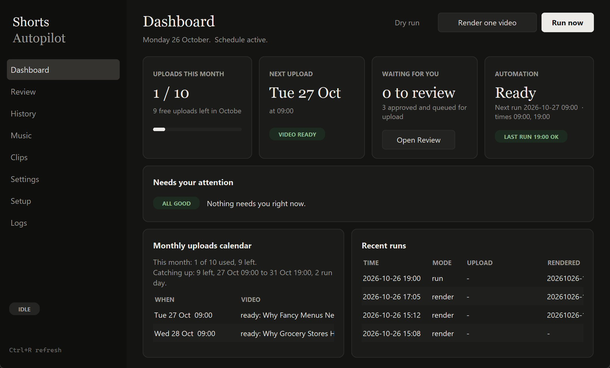

# Shorts Autopilot

A Windows app that runs a faceless YouTube Shorts channel almost on its own. It writes and renders Shorts with [MoneyPrinterTurbo](https://github.com/harry0703/MoneyPrinterTurbo), waits for **your approval**, then uploads the approved ones through [Upload-Post](https://upload-post.com). Uploads are spread evenly so every free monthly upload is used, without long gaps.



## What it does

```
 Twice a day (Windows Task Scheduler)
 ┌──────────────────────────────────────────────────────────────────────┐
 │ 1. Upload    if an upload slot is due → post the oldest approved video │
 │ 2. Render    if fewer than 3 videos are waiting → make a new one:     │
 │              topic → script → fast energetic voiceover (exact timing) │
 │              → clips looked at and placed per sentence → best-fit     │
 │              approved music + captions → review/                      │
 │ 3. Clean     delete MoneyPrinterTurbo caches older than 14 days       │
 └──────────────────────────────────────────────────────────────────────┘
          review/  ──you approve in the app──►  approved/  ──►  YouTube
```

- **Topics never repeat.** An LLM (Claude by default) picks a fresh topic in your niche every time.
- **Footage matches the script, to the second.** The voiceover is made first, so every sentence group ("beat") has exact timing. For each beat the app searches several free sources, then **Claude looks at the candidate clips as they will appear on a phone** and picks the best one for the words being spoken. Each clip is cut to the beat's exact length from the calm middle of the footage, so the picture changes when the words do. No clip repeats within a video. See [How clips are chosen](#how-clips-are-chosen).
- **Fun, energetic and a bit fast:** an expressive voice at +12% speed, a punchy fun script style, and upbeat music chosen to fit each video.
- **Readable captions:** bold font, large text, thick outline, centered so the Shorts UI doesn't cover them.
- **Copyright-safe music:** only tracks you've approved are used, otherwise voice only. 8 upbeat Mixkit tracks come ready to use. The AI picks the best fit for each video (or you fix one track, or swap the music per video in Review). See [SAFETY.md](SAFETY.md).
- **Approval required:** nothing is posted until you approve it.
- **Quota-aware schedule:** the remaining uploads are spread over the remaining run times of the month.

## Requirements

| What | Why | Cost |
|---|---|---|
| Windows 10/11, 8 GB RAM, ~10 GB free disk | rendering | - |
| [git](https://git-scm.com) and [uv](https://docs.astral.sh/uv/) | the installer uses them to set up MoneyPrinterTurbo | free |
| An LLM: [Claude Code](https://claude.com/claude-code) CLI (default, uses your Claude plan), or a DeepSeek / Gemini / OpenAI / OpenRouter key, or local Ollama | writes topics, scripts, search words, titles | plan or API cost |
| [Pixabay API key](https://pixabay.com/api/docs/) | stock footage (Pexels has paused new keys) | free |
| *Optional:* [Coverr API key](https://api.coverr.co/docs/) | a second footage source | free |
| [Upload-Post](https://upload-post.com) account with your YouTube channel connected | uploading | free plan: 10 uploads a month |

## Install

1. Clone this repo, for example to `D:\PROJECTS\shorts-autopilot`.
2. *(Optional)* To keep MoneyPrinterTurbo somewhere other than `D:\MPT`, copy `env.example.bat` to `env.bat` and edit `MPT_DIR`.
3. Double-click **`install.bat`**. It:
   - clones MoneyPrinterTurbo **v1.3.9** into `MPT_DIR` (skipped if it's already there)
   - installs Python 3.11 and MPT's packages with uv
   - opens the app
4. In the app, open the **Setup** tab and work down the checklist until every row is green ✔:
   - **Script writer:** choose `claude_code` (no key) or a provider and paste its key, then **Save**.
   - **Stock footage:** paste your Pixabay key, then **Save**. A Coverr key is optional and adds a second source.
   - **Upload-Post:** tick Enabled, paste the API key and enter the **profile name**, then **Save**. The profile name is the user listed on Upload-Post's *Users* page (often `default`), not your email.
   - **Daily schedule:** click **Register / repair schedule**.
   - Click **Run full check**: it tests the LLM, footage and Upload-Post in about 20 seconds.
   - Click **Create desktop shortcut** if you like.
5. On the **Dashboard**, click **Render one video now** and review it once it's done (about 10–15 minutes).

Later, open the app from the desktop shortcut or **`Shorts Autopilot.bat`**.

## Using the app

| Tab | What you do there |
|---|---|
| **Dashboard** | Uploads used this month, the next upload slot, queue sizes, schedule state and the last run. **Alerts** flag anything that needs you, such as an upload due with nothing approved. The **upload calendar** shows every planned slot this month and next, and which approved video will go out. **Recent runs** shows each run's upload and render result. Buttons: Run now, Render one video now, Dry run. |
| **Review** | Videos waiting for approval, each with a thumbnail, a ▶ Play button, the script, and an editable **YouTube title, description and tags**. **Approve** moves it to the upload queue. **Reject** asks *why* (a reason is required), deletes the video and keeps your reason to [teach future videos](#learning-from-your-rejections). **♪ Change music...** swaps the track of one video and redoes only the final mix (about a minute). The approved queue shows the upload order, and **Back to review** pulls one out. |
| **History** | Every upload (it counts against the quota), with status and Upload-Post request id. Uploads with an unclear outcome show under **Needs checking**: look in YouTube Studio, then mark **It's live** or **Not uploaded**. **Rejected videos** lists every rejection with your reason, and **What it learned...** shows the rules future videos follow. |
| **Music** | Your approved tracks with their mood tags (the AI uses the tags to match a track to each video). **▶ Listen** plays one. **Add track...** asks for the source, mood tags and a license confirmation. No tracks means voice-only videos. |
| **Clips** | Your own clip library: footage you download by hand from Mixkit, Vidsplay or Coverr. Add each with a source and a few tags, and the picker considers it whenever the tags match a scene. |
| **Settings** | Niche, language, voice, **voice speed**, script rules, uploads per month, run times, number of videos to keep waiting, **music mode** (AI best fit / always one track / none), music volume, cache cleanup, YouTube privacy. Changing the run times re-registers the schedule. You can also pause or resume the schedule here. |
| **Setup** | Health checklist with a fix button on every row (see Install). |
| **Logs** | The full run log, with a *Problems only* filter. |

### Your routine
Every day or two, open **Review**, watch the new videos, fix titles if needed and **Approve** the good ones. The Dashboard turns red when an upload slot is close and nothing is approved.

## Learning from your rejections

Rejecting a video is feedback, not just a delete. The app asks what was wrong:

| Reason | What it teaches |
|---|---|
| Footage doesn't match what's being said | **footage** rules: which clips to search for and keep |
| Weak or boring opening / script, wrong or risky claim, too long or short, something else | **script** rules: how the voiceover is written |
| Topic is dull, repetitive or off-niche | **topic** rules: which topics get picked |
| Voice, captions or music problem | logged only: change the voice, music volume or tracks in **Settings** and **Music** |

Add **details** when you can (for example *"animals in a money video, I want office and cash shots"*). Specific notes teach much better than a category alone.

How the learning works:
1. Each rejection is appended to `feedback.jsonl` with its reason, topic, title and the start of the script.
2. At the next render, the LLM condenses all feedback (newest wins on conflicts) into at most 8 short rules per area, saved in `lessons.json`. If the LLM can't, your raw notes are used instead. The rules are only rebuilt when there is new feedback.
3. The rules are added to the prompts that choose the **topic**, write the **script**, pick the **search words** and filter the **clips**. Rejected topics are never repeated either.
4. Each video's metadata records how many rules were applied (`lessons_applied`). **History → What it learned...** shows them in plain text.

This steers the prompts. It does not retrain a model, so a few specific rejections help more than many vague ones. To start over, delete `lessons.json` and `feedback.jsonl`.

## How upload spacing works

The task runs at each **run time** (default 09:00 and 19:00). On every run:

```
remaining = monthly_uploads - uploads already made this month
slots_left = run times left this month, including this one
upload now if  remaining >= slots_left               (must use every run to fit)
            or runs since the last upload >= slots_left / remaining
```

This spreads uploads evenly and uses the whole free quota. Example with 10 uploads a month:

| Month | Uploads |
|---|---|
| A full month (November) | 1, 4, 7, 10, 13, 16, 19, 22, 25, 28: about every 3 days (at 09:00) |
| Joining late (9 left on 26 Oct) | 27 Oct, then 09:00 and 19:00 from 28 to 31 Oct |

If nothing is approved when a slot comes, that slot is skipped and later slots catch up. It never goes over the monthly limit. On a paid Upload-Post plan, raise **Uploads per month** in Settings.

## Files and folders

```
shorts-autopilot/
├─ Shorts Autopilot.bat     open the app
├─ install.bat              one-time setup on a new PC
├─ run_daily.bat            one run (Task Scheduler and the app call it)
├─ setup_schedule.ps1       registers the "MPT Daily Shorts" task
├─ autopilot_gui.pyw        the app (Tkinter)
├─ daily_shorts.py          the engine: schedule, queue, music, learning, uploads
├─ footage.py               finding, looking at and placing clips
├─ env.example.bat          → env.bat (your MPT folder; not committed)
├─ safe_music/SOURCES.txt   approved music list with mood tags (audio files are not committed)
├─ clips/SOURCES.txt        your own clip library list (video files are not committed)
│
│  created while running (all git-ignored):
├─ review/  approved/  posted/  check/     videos (.mp4 + .json metadata)
├─ uploads.json             upload ledger (drives the quota)
├─ topics_used.txt          topic history (no repeats)
├─ feedback.jsonl           why you rejected videos
├─ lessons.json             rules distilled from that feedback
├─ settings.json            your Settings tab values
├─ work/<video>/            kept so the music of a waiting video can be swapped
└─ logs/daily.log, logs/runs.jsonl, .thumbs/
```

Each video is an `.mp4` plus a `.json` with `topic`, `title`, `description`, `tags`, `music`, `credits`, `clips`, `script` and `rendered`. You can edit the JSON by hand too.

## Settings reference (`settings.json`)

| Key | Default | Meaning |
|---|---|---|
| `niche` | money psychology and surprising personal finance facts | what every video is about |
| `language` | `en-US` | script and metadata language |
| `voice` | `en-US-GuyNeural-Male` | Edge TTS voice (free). Avoid the "Multilingual" voices: they time out on the free service |
| `voice_rate` | `1.12` | speaking speed (1.0 = normal) |
| `script_rules` | 130–150 words, fun and energetic, hook first, end with a question | instructions for the script writer |
| `monthly_uploads` | `10` | Upload-Post plan limit |
| `run_times` | `["09:00", "19:00"]` | when the task runs |
| `buffer` | `3` | stop rendering once this many videos are waiting |
| `music_mode` | `auto` | `auto` = the AI picks the best-fitting approved track, `fixed` = always `music_track`, `none` = voice only |
| `music_track` | empty | the track used when `music_mode` is `fixed` |
| `music_volume` | `0.2` | background music level |
| `clean_after_days` | `14` | delete MPT caches older than this (0 = never) |

MoneyPrinterTurbo's own settings (LLM, keys, Upload-Post, privacy) live in `MPT_DIR\config.toml`. The Setup tab edits them safely: it reads the file fresh and changes only the needed keys.

## Command line

Run from the MPT folder with MPT's Python, or simply through `run_daily.bat`:

```bat
run_daily.bat              :: a normal run (what the schedule does)
run_daily.bat --dry-run    :: show what would happen, change nothing
run_daily.bat --render     :: render one video now, never uploads
run_daily.bat --doctor     :: JSON health report
python daily_shorts.py --self-test      :: logic tests (no MPT needed)
python autopilot_gui.pyw --screenshot out.png [Tab]   :: app smoke test
```

## How clips are chosen

For every video the app does this (all in `footage.py`):

1. **Timing first.** MoneyPrinterTurbo makes the voiceover and its captions. The caption lines are grouped into *beats* of about 3.4 seconds. A beat starts exactly when its first words are spoken.
2. **A shot plan.** Claude writes two search queries per beat (a specific one and a broader fallback), with any footage lessons from your rejections.
3. **Many candidates.** Each beat searches Pixabay (and Coverr, if you added its key) plus your clip library, and keeps up to 8 candidates with the sources mixed. Landscape clips are accepted and cropped to vertical; Pixabay's 4K files are used when available so the crop stays sharp. This gives far more candidates than a vertical-only search.
4. **Claude looks.** For each beat the app builds a contact sheet of numbered tiles, each showing the clip as it will appear on a phone (9:16 center crop). Claude ranks the clips that best illustrate the spoken words, rejecting visible text or logos, off-topic subjects and dull footage. If Claude can't be reached, the search order is used.
5. **Placement.** Each chosen clip is trimmed to the beat's exact length from just before the middle of the footage (skipping the first and last frames). A beat longer than 4.2 seconds becomes two quick cuts. A clip that's slightly short is slowed down (never below 0.7x). No clip is used twice in one video.
6. **Final mix.** Captions, voiceover and the chosen music are added by MoneyPrinterTurbo's own mixer.

Sources and their rules:

| Source | How it's used | Terms |
|---|---|---|
| Pixabay | API, automatic | Pixabay license: free, including monetized YouTube |
| Coverr | official API, automatic, needs your free key | Coverr asks API users for credit; the description gets "Footage: Coverr (coverr.co)" when a Coverr clip is used |
| Mixkit | **by hand only**: you download clips and add them in the **Clips** tab | Mixkit's user terms forbid scripts or bots that mass-download or scrape, so the app never fetches from Mixkit |
| Vidsplay | **by hand only** (no API) | free for commercial use, but requires a visible credit link to Vidsplay.com; added to the description automatically |

Read each site's license yourself before relying on it; you're responsible for what you post.

## Music

- Eight upbeat, fast Mixkit tracks are listed in `safe_music/SOURCES.txt` with mood tags and are ready to use (tempo roughly 110-170 BPM, estimated).
- **Music mode** in Settings: *Best fit for each video* (Claude reads the script and the tags, and avoids the tracks used by the last two videos), *Always the same track*, or *No music*.
- In **Review**, **♪ Change music...** remixes one video with another track (or none) without redoing the footage. It works while the video is still in review or approved; the working files are deleted once it's posted or rejected.
- The voice is `en-US-GuyNeural` at +12% speed by default. Try other voices in Settings (run **Setup → Run full check** first to fill the list).

## Troubleshooting

| Problem | Fix |
|---|---|
| Settings you saved get reverted | MoneyPrinterTurbo's WebUI (port 8501) rewrites `config.toml` from memory. Close it while using the automation; the Setup tab warns when it's open. |
| A key typed into MPT's WebUI doesn't save | WebUI text fields only save when you press Enter or click away. Prefer the Setup tab. |
| "Pexels key issuance paused" | Use Pixabay (the default here). |
| Footage doesn't fit | Reject the video and say what was wrong (Footage reason): the lesson is applied to the next shot plans. Add better clips in the **Clips** tab, or a Coverr key in Setup for more candidates. |
| "Vision pick failed" in the log | The Claude CLI couldn't read the contact sheets (not installed, not logged in, or usage limit). The first search result is used instead, so videos still finish but match less well. |
| An upload is in **Needs checking** | The connection dropped mid-upload. Look in YouTube Studio, then click *It's live* or *Not uploaded*. It's never retried automatically, so you don't get double posts. |
| A Short got a copyright claim | See [SAFETY.md](SAFETY.md): remove the track in the Music tab and fix the video in Studio. |
| Nothing ran at 09:00 | The PC must be on or asleep (it wakes for the task), not shut down. A missed run starts when the PC comes back. Check **Settings → Schedule** and **Logs**. |
| "Another run is in progress" | Normal when a manual run overlaps a scheduled one. Only one runs at a time. |
| Disk filling up | MPT caches are cleaned after `clean_after_days`. Posted videos stay in `posted/`; delete old ones when you like. |

## Credits and license

- Voiceover, captions and final mix: [MoneyPrinterTurbo](https://github.com/harry0703/MoneyPrinterTurbo) by harry0703 (MIT). This project uses it unmodified.
- Footage: [Pixabay](https://pixabay.com/service/license-summary/), [Coverr](https://coverr.co/license). Music: [Mixkit](https://mixkit.co/license/). Uploading: [Upload-Post](https://upload-post.com).
- Shorts Autopilot is MIT licensed, see [LICENSE](LICENSE). Use it within YouTube's policies; you're responsible for what your channel posts.
